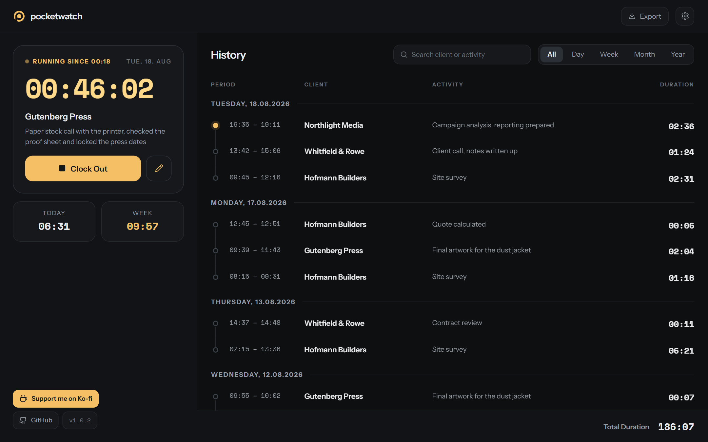
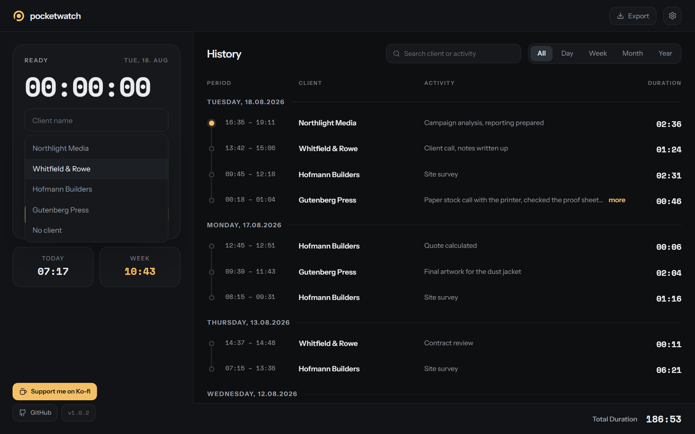
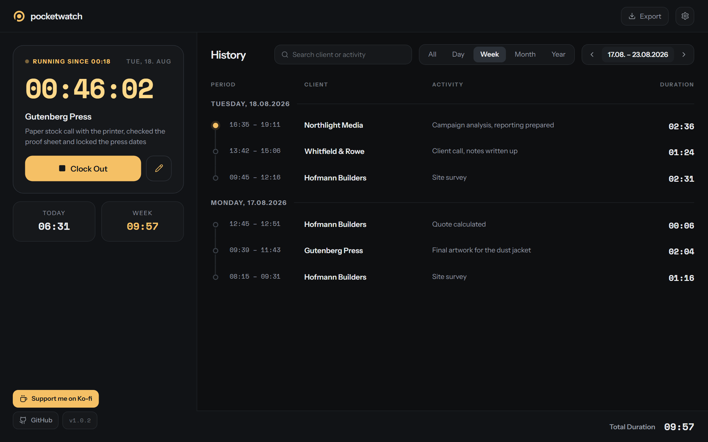
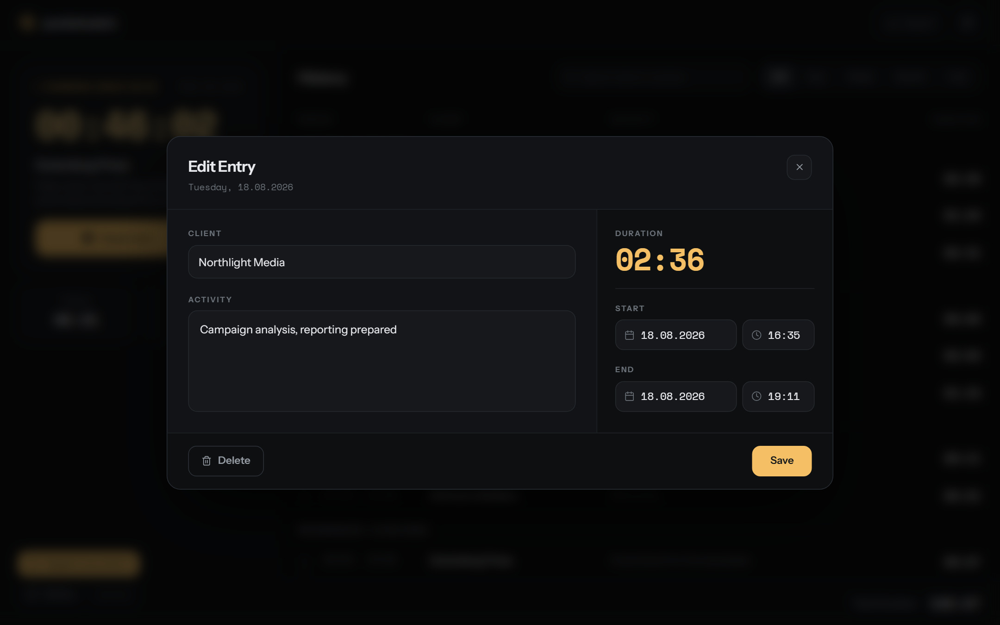
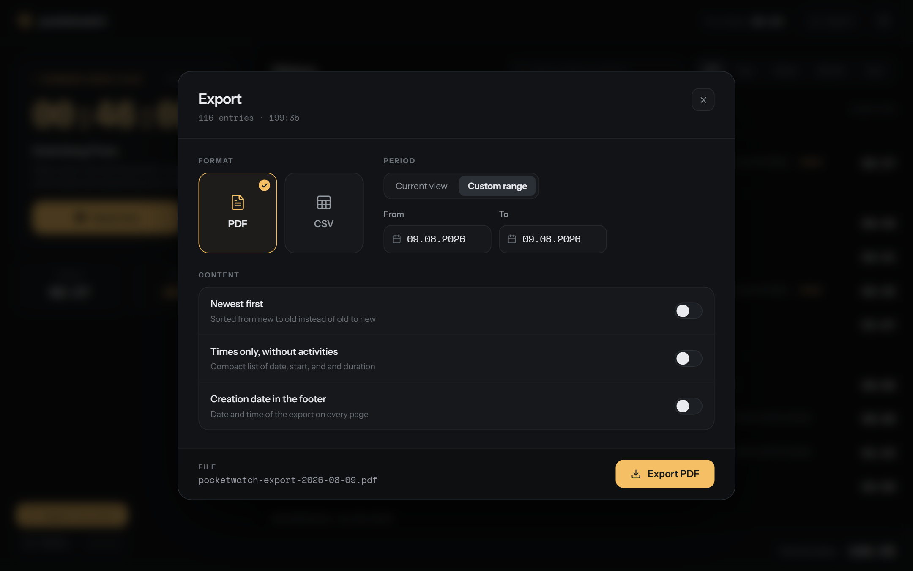
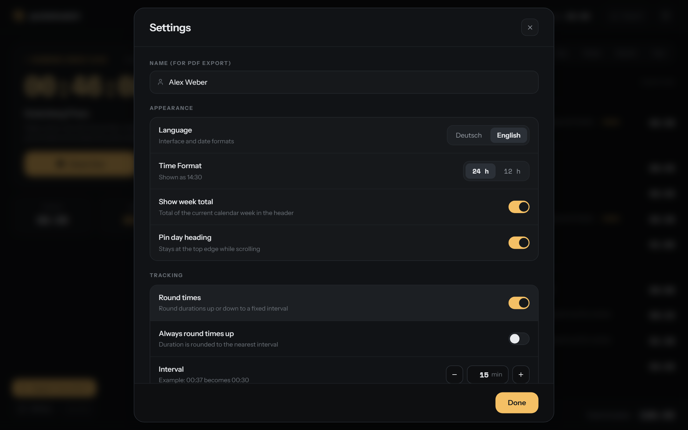
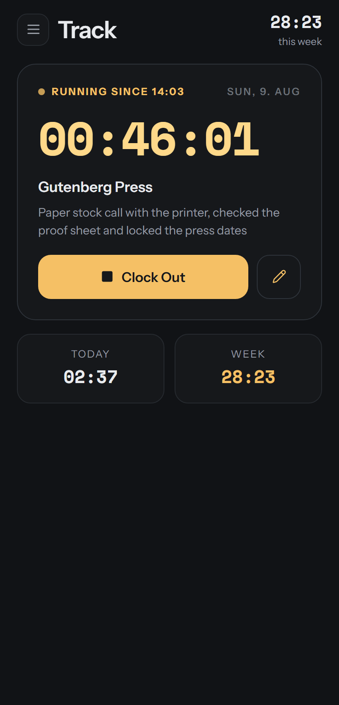
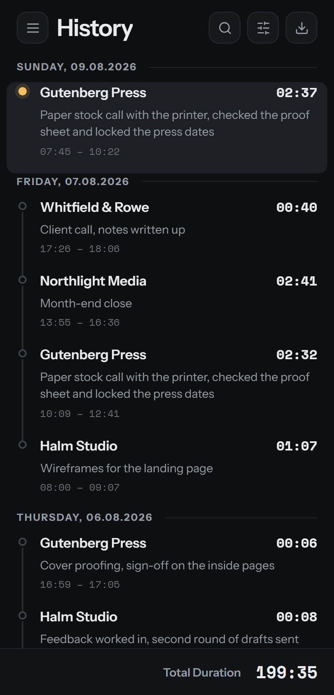
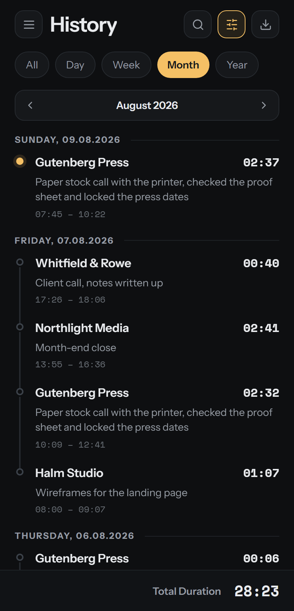
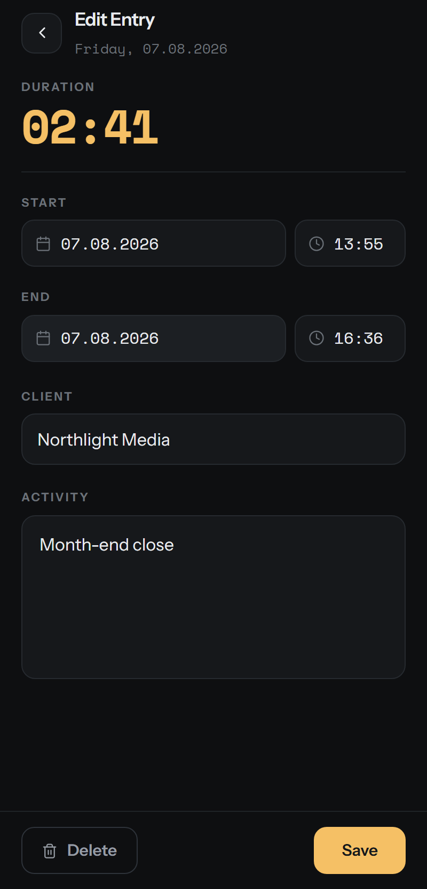

<div align="center">


# pocketwatch

Minimal time tracking.<br>
Start the timer with one click. Send the PDF to the client. All data stays on your machine.

[Live demo](https://winnicodes.github.io/pocketwatch/) · [Installation](#installation) · [Development](docs/dev.md)

  

</div>

<br>



## Why pocketwatch?

- **Your data stays yours.** Two JSON files on your disk. No account, no subscription, no tracking, no cloud.
- **Fast.** No database, no loading spinner. Start and stop are one click. The timer continues after a reload.
- **Ready to invoice.** PDF report with your name on it, or CSV for your spreadsheet.
- **Desktop and phone.** Two columns on a large screen, one view at a time on a phone.
- **One container.** `docker compose up -d` – runs on a NAS or a laptop.

> [!TIP]
> The [live demo](https://winnicodes.github.io/pocketwatch/) is a single HTML file with the full app and demo data. Nothing is saved; a reload starts it again.

## Features

| | |
|---|---|
| **Track** – client list, most recent first; timer to the second; edit the activity while it runs; totals for today and this week; notice after 8 hours. | **History** – search client and activity; grouped by day with a sticky day heading; long text expands with *more*; total of the selection in the footer. |
|  |  |
| **Period** – Day, Week, Month or Year, with arrows to step back and forth. **All** shows the full history. | **Edit** – start and end with date and time; duration updates immediately; keyboard-friendly pickers; an end before the start is rejected; delete asks first. |
|  |  |
| **Export** – PDF with your name and page numbers, or CSV (semicolons, BOM for Excel). Current view, a standard period or a date range; newest first; optionally times only. | **Settings** – name for the PDF; German or English; 12 or 24 hours; sticky day heading; long-timer reminder; round times to 1–60 minutes. |
|  |  |

<details>
<summary><b>On the phone</b></summary>
<br>

Below 1024 px the app shows one view at a time. Search, filter and export move into the header, table rows become cards and dialogs fill the screen. With “Add to Home Screen” pocketwatch opens without a browser bar.

<table>
<tr>
<td width="25%"></td>
<td width="25%"></td>
<td width="25%"></td>
<td width="25%"></td>
</tr>
<tr>
<td></td>
<td></td>
<td></td>
<td></td>
</tr>
</table>

</details>

## Installation

The image is on the GitHub Container Registry. No build, no Node.js on the host.

```bash
docker run -d --name pocketwatch -p 8080:80 \
  -v "$(pwd)/data:/var/www/html/data" \
  ghcr.io/winnicodes/pocketwatch:latest
```

Open <http://localhost:8080>. Or put [docker-compose.yaml](docker-compose.yaml) in an empty folder and run `docker compose up -d`.

Pin a version tag (e.g. `ghcr.io/winnicodes/pocketwatch:1.2.0`) if you want to control when you update.

**Update**

```bash
docker compose pull && docker compose up -d
```

<details>
<summary><b>Unraid</b></summary>
<br>

pocketwatch is in **Community Applications**: *Apps* → search `pocketwatch` → *Install*. The defaults are correct:

| Setting | Default |
|---|---|
| WebUI | `8080` (host) → `80` (container) |
| Data | `/mnt/user/appdata/pocketwatch` → `/var/www/html/data` |

Update via *Docker → Check for Updates → Apply*. PUID/PGID are not needed; the container fixes the owner of the appdata folder at start.

Without Community Applications: *Docker → Add Container* with repository `ghcr.io/winnicodes/pocketwatch:latest` and the port and path above. The image is `linux/amd64`.

</details>

## Data and privacy

All data lives in the mounted `data/` folder:

- `times.json` – the time entries
- `config.json` – the settings

Writes go to a temporary file that is then renamed, so an interrupted write cannot damage your data. To back up, copy the folder.

pocketwatch sends nothing and loads nothing from outside: no analytics, no external fonts, no external API.

> [!WARNING]
> The API has **no authentication**. Run pocketwatch in your own LAN only. Anyone who can open the URL can read and change all entries. For outside access, use a reverse proxy with authentication or a VPN.

## Upcoming features

- Desktop client and Android app
- Themes
- Multiple profiles

## Development

Architecture, build, project layout, tech stack and release: see [docs/dev.md](docs/dev.md).

## Support

Problems and feature requests: [GitHub Issues](../../issues).
If pocketwatch saves you time, you can [buy me a coffee on Ko-fi](https://ko-fi.com/winnicodes).

## License

[MIT](LICENSE)
