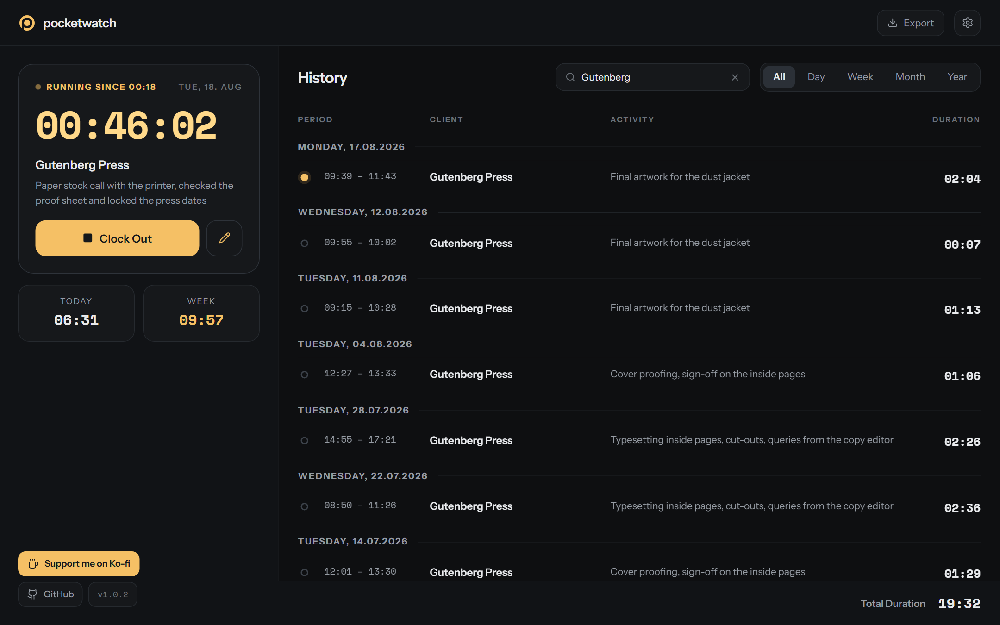
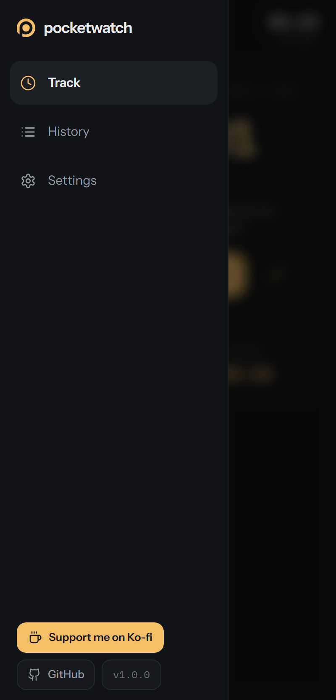
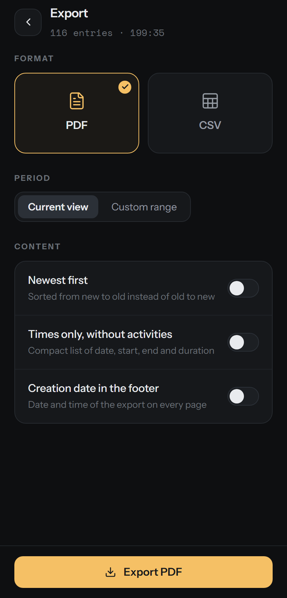
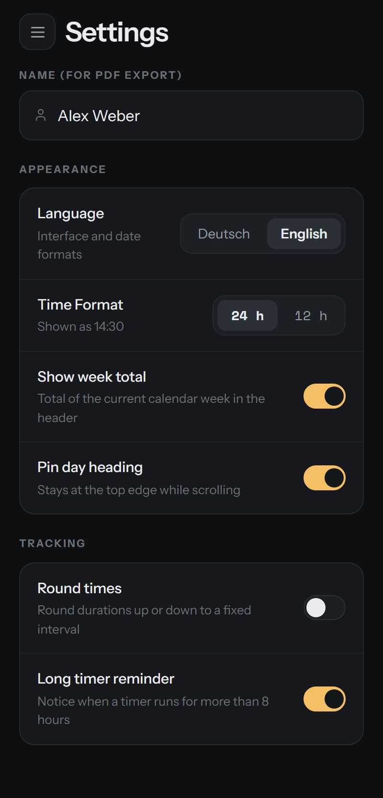

<div align="center">


# pocketwatch

**Time tracking for freelancers and the self-employed.
Start the timer with one click. Send the PDF to the client. All data stays on your machine.**


</div>


---

## 🚀 Try it yourself

**[▶ Open the live demo](https://winnicodes.github.io/pocketwatch/)**

The demo is one HTML file. It contains the full app and demo data. You do not need a
server, Docker or an internet connection. You can start, stop, search, filter, edit and
export. The demo does not save data. If you reload the page, the demo starts again.

---

## 💡 Why pocketwatch?

|  | |
|---|---|
| 🔒 **Your data stays yours** | The app writes two JSON files to your disk. There is no account, no subscription and no tracking. No data leaves the machine. The container also contains the fonts. |
| ⚡ **Fast** | There is no database and no loading spinner. Start and stop are one click. The timer counts each second and continues after a reload. |
| 🧾 **Ready to invoice** | Make a PDF report with your name on it, or a CSV file for your spreadsheet. Export the filtered view or a date range. |
| 📱 **Desktop and phone** | The layout has two columns on a large screen. On a phone it shows one view at a time. |
| 🐳 **One container** | Use `docker compose up -d`. The container runs on a NAS or a laptop. |

---

## 🎬 Functions

### ⏱️ Track

- 📇 Client list, most recent first
- ⏱️ Timer to the second
- ✍️ Change the activity while the timer runs
- 📊 Totals for today and this week
- ⚠️ Notice after 8 hours


### 📜 History

- 🔍 Search in the client and the activity
- 📅 Grouped by day
- 📌 The day heading stays at the top
- ➕ Long text expands with **more**
- Σ Total of the selection in the footer



### 🗓️ Period

Select **Day**, **Week**, **Month** or **Year**. Use the arrows to go to an earlier or a later
period. The total changes with the period. Select **All** to show the full history.


### ✏️ Edit

- 📆 Start and end with date and time
- ⏳ The duration updates immediately
- ⌨️ Pickers that you can operate with the keyboard
- 🚫 The app rejects an end before the start
- ❓ Delete asks first


### 📤 Export

- 📄 PDF report with your name and page numbers
- 📊 CSV with semicolons and a BOM for Excel
- 🎯 Current view, a standard period or a date range
- 🔀 Newest first
- ✂️ Times only, without activities


### ⚙️ Settings

- 👤 Name for the PDF
- 🌐 German or English
- 🕐 12-hour or 24-hour
- 📌 Pin the day heading
- ⚠️ Reminder for a long timer
- 🔢 **Round times** to an interval from 1 to 60 minutes, up or to the nearest interval


---

## 📱 Responsive

Below 1024 px the app shows one view at a time. Use the drawer to change the view. Search,
filter and export move into the header. Table rows become cards. Dialogs fill the screen.

<table>
<tr>
<td width="25%"><br><sub>⏱️ <b>Track</b></sub></td>
<td width="25%"><br><sub>📜 <b>History</b></sub></td>
<td width="25%"><br><sub>☰ <b>Drawer</b></sub></td>
<td width="25%"><br><sub>🗓️ <b>Period</b></sub></td>
</tr>
<tr>
<td><br><sub>✏️ <b>Edit</b></sub></td>
<td><br><sub>📤 <b>Export</b></sub></td>
<td><br><sub>⚙️ <b>Settings</b></sub></td>
<td valign="middle"><sub>The app has a manifest, icons and a theme colour. Use “Add to Home Screen” to open pocketwatch without a browser bar.</sub></td>
</tr>
</table>

---

## 🐳 Installation with Docker

The image is on the GitHub Container Registry. You do not have to compile it, and you do
not need Node.js on the host:

```bash
docker run -d --name pocketwatch -p 8080:80 \
  -v "$(pwd)/data:/var/www/html/data" \
  ghcr.io/winnicodes/pocketwatch:latest
```

Open <http://localhost:8080>. The app writes the time entries to the mounted `data/` folder.

With docker-compose: put [docker-compose.yaml](docker-compose.yaml) in an empty folder and run
`docker compose up -d`.

Each release also has a version tag, for example `ghcr.io/winnicodes/pocketwatch:1.2.0`. Use
a version tag if you want to control when you update.

### Unraid

pocketwatch is in **Community Applications**. Open the *Apps* tab, search for `pocketwatch`
and select *Install*. The template contains the WebUI link, the port and the appdata path.
The default values are correct:

| Setting | Default |
|---|---|
| WebUI | `8080` (host) → `80` (container) |
| Data | `/mnt/user/appdata/pocketwatch` → `/var/www/html/data` |

To update, use *Docker → Check for Updates → Apply*. You do not have to set PUID or PGID.
The container corrects the owner of the appdata folder at start.

<details>
<summary>Add the container manually</summary>

Do this only if you do not use Community Applications. Select *Docker → Add Container*, then:

| Field | Value |
|---|---|
| Repository | `ghcr.io/winnicodes/pocketwatch:latest` |
| Port | `8080` (host) → `80` (container) |
| Path | `/mnt/user/appdata/pocketwatch` (host) → `/var/www/html/data` (container) |

</details>

The image is `linux/amd64`. Unraid uses this architecture.

---

## 🛡️ Security and privacy

pocketwatch does not collect data, does not send data and does not load external files.
There is no analytics, there are no fonts from Google and there is no external API.

> **Warning:** the API has **no authentication**. Use pocketwatch in your own LAN only. Do
> not connect the container to the internet. A person who opens the URL can read and change
> all time entries. For access from outside, put a reverse proxy with authentication or a
> VPN in front of the container.

---

## 💾 Data

All data is in the mounted `data/` folder:

- `data/times.json` - the time entries
- `data/config.json` - the settings (name, language, time format, rounding)

The app writes to a temporary file and then renames it. An interrupted write cannot damage
a good file. If the folder is mounted on the host, the data stays after an update and after
a rebuild of the container.

To make a backup, copy the `data/` folder.

---

## 🔁 Updates

```bash
docker compose pull
docker compose up -d
```

---

## 🛠️ Development

Architecture, build, project layout, tech stack and release: see [docs/dev.md](docs/dev.md).

---

## ❤️ Support

Please report problems and feature requests with GitHub Issues.

If pocketwatch saves you time, you can buy me a coffee:
**[ko-fi.com/winnicodes](https://ko-fi.com/winnicodes)**. The same link is at the bottom
left in the app.

---

## 📜 License

MIT - see [LICENSE](LICENSE). You can use it and change it.
